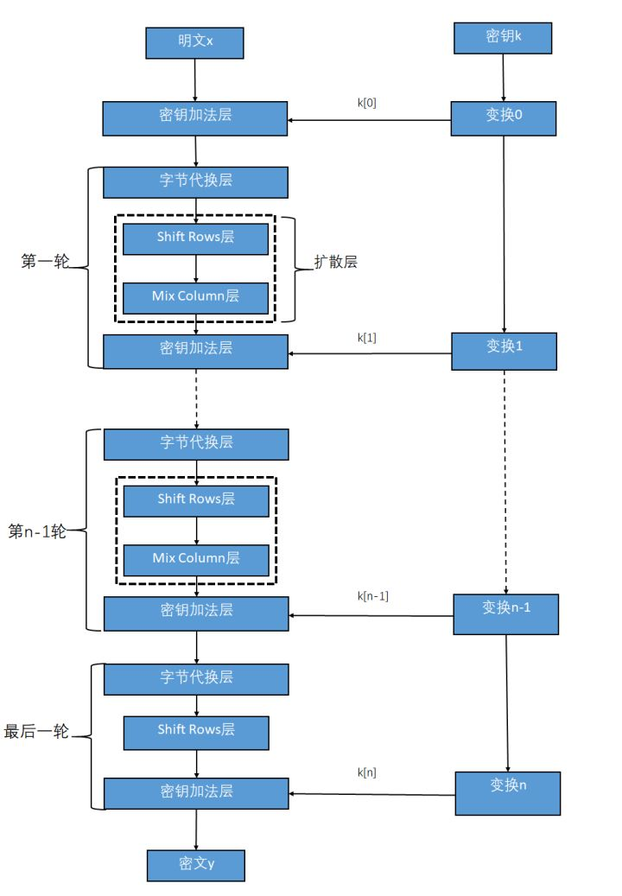
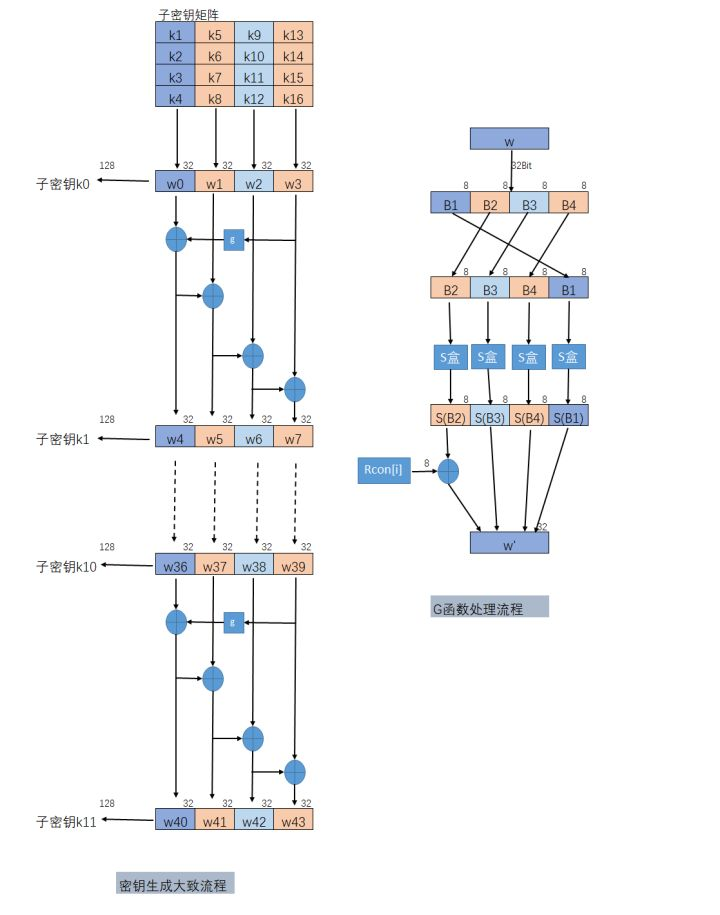
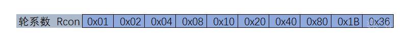
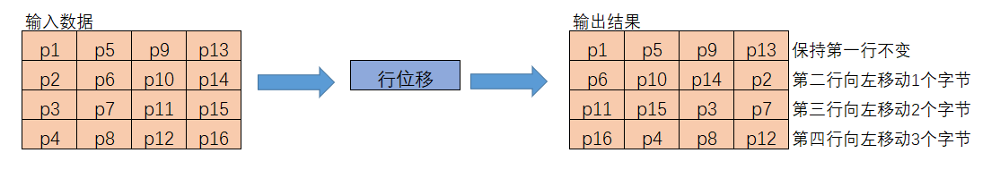
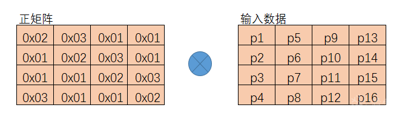

# 密码学基础  AES算法C语言实现

*作为密码学的第一篇blog，首先将字符和位的关系说明清楚：*

通常情况下一字节等于八位，通常在读取图片、声音、可执行文件需要用字节数组来保存文件，在下载文件也是用byte数组来做临时的缓冲器接收文件内容。

字符(Character)计算机中使用的字母、数字、字和符号，比如’P’、’K’、’%’、’#’等。

==一般在英文状态下一个字母或字符占用一个字节，一个汉字用两个字节表示。==

- ASCII 码中，一个英文字母(不分大小写)为一个字节，一个中文汉字为两个字节。
- UTF-8 编码中，一个英文字为一个字节，一个中文为三个字节。
- Unicode 编码中，一个英文为一个字节，一个中文为两个字节。
- 符号：英文标点为一个字节，中文标点为两个字节。例如：英文句号 **.** 占1个字节的大小，中文句号 **。**占2个字节的大小。
- UTF-16 编码中，一个英文字母字符或一个汉字字符存储都需要 2 个字节(Unicode 扩展区的一些汉字存储需要 4 个字节)。
- UTF-32 编码中，世界上任何字符的存储都需要 4 个字节。

## AES简介

是DES的替代算法，同样也是对称加密算法

- 和DES一样，能有效抵御所有已知攻击；
- 加密算法易于现有软硬件平台的实现，且加解密过程效率优于DES；
- 具有典型的对称分组加密算法特性，以快速混淆和扩散为设计原则，本质是轮函数过程的循环。

***AES的数据分组长度统一为128位，而密钥空间可根据需要采用128位、192位和256位三种不同长度。和大多数分组加密算法不一样AES的轮函数并没有采用Feistel结构设计，而是使用了3个不同的可逆均匀变换。***

### AES算法主要步骤

1. 密钥扩展（Key Expansion），使用密钥扩展算法将128位用户主密钥扩展成R个轮密钥；
2. 初始轮（Init Round），即为轮密钥加；
3. 重复轮（Rounds），每一轮包括：字节替换（SubBytes），行移位（Shift Rows），列混合（Mix Columns），轮密钥加（Add Round Key）四个步骤；
4. 最终轮（Final Round），最终轮比重复轮少了列混合的步骤。

==最后一轮是不用列混合操作的==

### AES算法具体内容

[](https://pic4.zhimg.com/80/v2-b22e3bdd7da5ddf5ea6ff71909dac4b7_720w.jpg)


在讲述密钥加法层之前，我们来看看密钥的扩展

#### 密钥扩展

[](https://pic4.zhimg.com/80/v2-3027156eb00bcddcdac69657c8aad1e7_720w.jpg)

**子密钥的生成是以列为单位进行的，一列是32Bit，四列组成子密钥共128Bit。生成子密钥的数量比AES算法的轮数多一个，因为第一个密钥加法层进行密钥漂白时也需要子密钥。**

==也就是密钥的扩展比算法的轮数多一个==

如果i不是4的倍数，那么第i列如下：

```
w[i]=w[i-4]⊕w[i-1]
```

如果i是4的倍数，那么第i列如下：

```
w[i]=w[i-4]⊕T(w[i-1])
```

其中T是一个复杂的函数

**函数T()首先将4个输入字节进行翻转，并执行一个按字节的S盒代换，最后用第一个字节与轮系数Rcon进行异或运算。轮系数是一个有10个元素的一维数组，一个元素1个字节。T()函数存在的目的有两个，一是增加密钥编排中的非线性；二是消除AES中的对称性（防止不同轮的产生的轮密钥的对称性或者相似性）。这两种属性都是抵抗某些分组密码攻击必要的。**

[](https://pic3.zhimg.com/80/v2-718685429c353bdf13b0d1fa5646ca1a_720w.png)


```
const unsigned int Rcon[11] = {0x00,0x01,0x02,0x04,0x08,0x10,0x20,0x40,0x80,0x1B,0x36};
int Key_S_Substitution(unsigned char(*ExtendKeyArray)[44], unsigned int nCol)
{
int ret = 0;

for (int i = 0; i < 4; i++)
{
ExtendKeyArray[i][nCol] = S_Table[(ExtendKeyArray[i][nCol]) >> 4][(ExtendKeyArray[i][nCol]) & 0x0F];
}

return ret;
}
int T_Function(unsigned char(*ExtendKeyArray)[44], unsigned int nCol)   
    //T函数
{
int ret = 0;
//1、将扩展密钥矩阵的nCol-1列复制到nCol列上，并将nCol列第一行的元素移动到最后一行，其他行数上移一行
for (int i = 0; i < 4; i++)
{
ExtendKeyArray[i][nCol] = ExtendKeyArray[(i + 1) % 4][nCol - 1];
}
    
//2、将nCol列进行S盒替换
Key_S_Substitution(ExtendKeyArray, nCol);
    
//3、将该列第一行元素与Rcon进行异或运算
ExtendKeyArray[0][nCol] ^= Rcon[nCol / 4];

return ret;
}
int CalculateExtendKeyArray(const unsigned char(*PasswordArray)[4], unsigned char(*ExtendKeyArray)[44])
{
int ret = 0;

//1、将密钥数组放入前四列扩展密钥组
for (int i = 0; i < 16; i++)
{
ExtendKeyArray[i & 0x03][i >> 2] = PasswordArray[i & 0x03][i >> 2];
}

//2、计算扩展矩阵的后四十列
for (int i = 1; i < 11; i++) //进行十轮循环
{
//(1)如果列号是4的倍数，这执行G函数 否则将nCol-1列复制到nCol列上
G_Function(ExtendKeyArray, 4*i);

//(2)每一轮中，各列进行异或运算
// 列号是4的倍数
for (int k = 0; k < 4; k++)//行号
{
ExtendKeyArray[k][4 * i] = ExtendKeyArray[k][4 * i] ^ ExtendKeyArray[k][4 * (i - 1)];
}

// 其他三列
for (int j = 1; j < 4; j++)//每一轮的列号
{
for (int k = 0; k < 4; k++)//行号
{
ExtendKeyArray[k][4 * i + j] = ExtendKeyArray[k][4 * i + j - 1] ^ ExtendKeyArray[k][4 * (i - 1) + j];
}
}
}

return ret;
}
Copy
```

#### 密钥加法层

**在密钥加法层中有两个输入的参数，分别是明文和子密钥k[0]，而且这两个输入都是128位的。**

```
int AddRoundKey(unsigned char(*PlainArray)[4], unsigned char(*ExtendKeyArray)[44], unsigned int MinCol)
{
int ret = 0;

for (int i = 0; i < 4; i++)
{
for (int j = 0; j < 4; j++)
{
PlainArray[i][j] ^= ExtendKeyArray[i][MinCol + j];
}
}

return ret;
}
Copy
```

#### 字节代换层（S盒）

就是把字节一个个放入s盒之中

```
const unsigned char S_Table[16][16] =
{
0x63, 0x7C, 0x77, 0x7B, 0xF2, 0x6B, 0x6F, 0xC5, 0x30, 0x01, 0x67, 0x2B, 0xFE, 0xD7, 0xAB, 0x76,
0xCA, 0x82, 0xC9, 0x7D, 0xFA, 0x59, 0x47, 0xF0, 0xAD, 0xD4, 0xA2, 0xAF, 0x9C, 0xA4, 0x72, 0xC0,
0xB7, 0xFD, 0x93, 0x26, 0x36, 0x3F, 0xF7, 0xCC, 0x34, 0xA5, 0xE5, 0xF1, 0x71, 0xD8, 0x31, 0x15,
0x04, 0xC7, 0x23, 0xC3, 0x18, 0x96, 0x05, 0x9A, 0x07, 0x12, 0x80, 0xE2, 0xEB, 0x27, 0xB2, 0x75,
0x09, 0x83, 0x2C, 0x1A, 0x1B, 0x6E, 0x5A, 0xA0, 0x52, 0x3B, 0xD6, 0xB3, 0x29, 0xE3, 0x2F, 0x84,
0x53, 0xD1, 0x00, 0xED, 0x20, 0xFC, 0xB1, 0x5B, 0x6A, 0xCB, 0xBE, 0x39, 0x4A, 0x4C, 0x58, 0xCF,
0xD0, 0xEF, 0xAA, 0xFB, 0x43, 0x4D, 0x33, 0x85, 0x45, 0xF9, 0x02, 0x7F, 0x50, 0x3C, 0x9F, 0xA8,
0x51, 0xA3, 0x40, 0x8F, 0x92, 0x9D, 0x38, 0xF5, 0xBC, 0xB6, 0xDA, 0x21, 0x10, 0xFF, 0xF3, 0xD2,
0xCD, 0x0C, 0x13, 0xEC, 0x5F, 0x97, 0x44, 0x17, 0xC4, 0xA7, 0x7E, 0x3D, 0x64, 0x5D, 0x19, 0x73,
0x60, 0x81, 0x4F, 0xDC, 0x22, 0x2A, 0x90, 0x88, 0x46, 0xEE, 0xB8, 0x14, 0xDE, 0x5E, 0x0B, 0xDB,
0xE0, 0x32, 0x3A, 0x0A, 0x49, 0x06, 0x24, 0x5C, 0xC2, 0xD3, 0xAC, 0x62, 0x91, 0x95, 0xE4, 0x79,
0xE7, 0xC8, 0x37, 0x6D, 0x8D, 0xD5, 0x4E, 0xA9, 0x6C, 0x56, 0xF4, 0xEA, 0x65, 0x7A, 0xAE, 0x08,
0xBA, 0x78, 0x25, 0x2E, 0x1C, 0xA6, 0xB4, 0xC6, 0xE8, 0xDD, 0x74, 0x1F, 0x4B, 0xBD, 0x8B, 0x8A,
0x70, 0x3E, 0xB5, 0x66, 0x48, 0x03, 0xF6, 0x0E, 0x61, 0x35, 0x57, 0xB9, 0x86, 0xC1, 0x1D, 0x9E,
0xE1, 0xF8, 0x98, 0x11, 0x69, 0xD9, 0x8E, 0x94, 0x9B, 0x1E, 0x87, 0xE9, 0xCE, 0x55, 0x28, 0xDF,
0x8C, 0xA1, 0x89, 0x0D, 0xBF, 0xE6, 0x42, 0x68, 0x41, 0x99, 0x2D, 0x0F, 0xB0, 0x54, 0xBB, 0x16
};

//字节代换
int Plain_S_Substitution(unsigned char *PlainArray)
{
int ret = 0;

for (int i = 0; i < 16; i++)
{
PlainArray[i] = S_Table[PlainArray[i] >> 4][PlainArray[i] & 0x0F];
}

return ret;
}
Copy
```

#### 行移位

[](https://pic2.zhimg.com/v2-581b444c6583aff31afe66b0391d73c1_r.jpg)


```
int ShiftRows(unsigned int *PlainArray)
{
int ret = 0;

//第一行 不移位
//PlainArray[0] = PlainArray[0];

//第二行 左移8Bit
PlainArray[1] = (PlainArray[1] >> 8) | (PlainArray[1] << 24);

//第三行 左移16Bit
PlainArray[2] = (PlainArray[2] >> 16) | (PlainArray[2] << 16);

//第四行 左移24Bit
PlainArray[3] = (PlainArray[3] >> 24) | (PlainArray[3] << 8);

return ret;
}
Copy
```

#### 列混淆

[](https://pic2.zhimg.com/80/v2-8d1c58108b9d719a8674d7703ead7991_720w.jpg)


```
const unsigned char MixArray[4][4] =
{
0x02, 0x03, 0x01, 0x01,
0x01, 0x02, 0x03, 0x01,
0x01, 0x01, 0x02, 0x03,
0x03, 0x01, 0x01, 0x02
};

int MixColum(unsigned char(*PlainArray)[4])
{
int ret = 0;
//定义变量
unsigned char ArrayTemp[4][4];

//初始化变量
memcpy(ArrayTemp, PlainArray, 16);

//矩阵乘法 4*4
for (int i = 0; i < 4; i++)
{
for (int j = 0; j < 4; j++)
{
PlainArray[i][j] =
GaloisMultiplication(MixArray[i][0], ArrayTemp[0][j]) ^
GaloisMultiplication(MixArray[i][1], ArrayTemp[1][j]) ^
GaloisMultiplication(MixArray[i][2], ArrayTemp[2][j]) ^
GaloisMultiplication(MixArray[i][3], ArrayTemp[3][j]);
}
}
return ret;
}
Copy
```

**接下来我们就只用处理伽罗瓦域乘法相关处理了，由于前面介绍过相关概念，所以代码就不在此进行讲解了，大家可以参考下方的代码注释进行理解：**

```
///////////////////////////////////////////////////////////////
//功能: 伽罗瓦域内的乘法运算 GF(128)
//参数: Num_L 输入的左参数
// Num_R 输入的右参数
//返回值:计算结果
char GaloisMultiplication(unsigned char Num_L, unsigned char Num_R)
{
//定义变量
unsigned char Result = 0; //伽罗瓦域内乘法计算的结果

while (Num_L)
{
//如果Num_L最低位是1就异或Num_R，相当于加上Num_R * 1
if (Num_L & 0x01)
{
Result ^= Num_R;
}

//Num_L右移一位，相当于除以2
Num_L = Num_L >> 1;

//如果Num_R最高位为1
if (Num_R & 0x80)
{
//左移一位相当于乘二
Num_R = Num_R << 1; //注：这里会丢失最高位，但是不用担心

Num_R ^= 0x1B; //计算伽罗瓦域内除法Num_R = Num_R / (x^8(刚好丢失最高位) + x^4 + x^3 + x^1 + 1)
}
else
{
//左移一位相当于乘二
Num_R = Num_R << 1;
}
}
return Result;
}
```