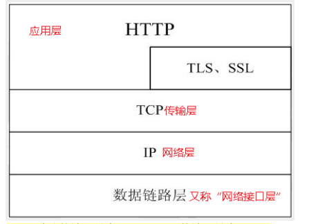
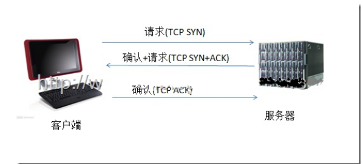
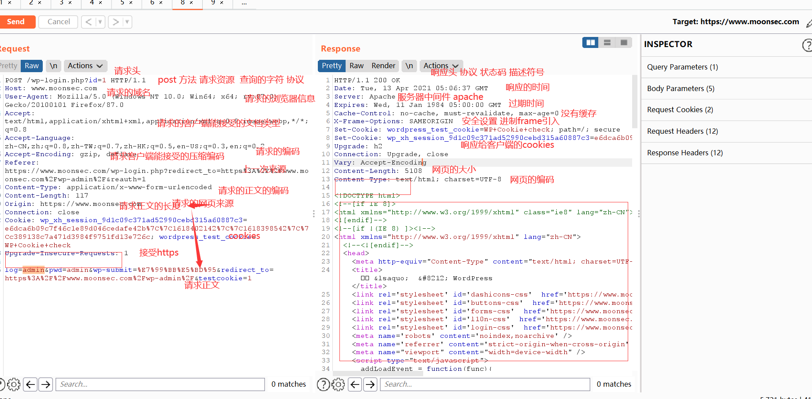

## HTTP协议

### 概念

超文本传输协议(HTTP)是一种通信协议，它允许将超文本标记语言(HTML)文档从Web服务器传送到客户端的浏览器。

HTTP是一个应用层协议，由请求和响应构成，是一个标准的客户端服务器模型。



### 特点

HTTP协议永远都是客户端发起请求，服务器回送响应。

1、安全认证

2、快速、灵活

3、HTTP 1.0使用非持续连接：限制每次连接只处理一个请求，服务器处理完客户的请求，并收到客户的应答后，即断开连接。HTTP 1.1使用持续连接：不必为每个web对象创建一个新的连接，一个连接可以传送多个对象，采用这种方式可以节省传输时间。

4、无状态

并不是无连接

从HTTP/1.1起，默认都开启了Keep-Alive，保持连接特性，简单地说，当一个网页打开完成后，客户端和服务器之间 用于传输HTTP数据的TCP连接不会关闭，如果客户端再次访问这个服务器上的网页，会继续使用这一条已经建立的连接。Keep-Alive是有时间限制的

### 工作流程

1）首先客户机与服务器需要建立连接。

 2）建立连接后，客户机发送一个请求给服务器

 3）服务器接到请求后，给予相应的响应信息 

4）客户端接收服务器所返回的信息通过浏览器显示在用户的显示屏上，然后客户机与服务器断开连接。 

==增加安全性的话可以加个代理服务器==

以HTTP在开始传输之前，首先需要建立TCP连接，而TCP连接的过程需要所谓的“三次握手”。



### HTTP之URL

HTTP使用统一资源标识符（Uniform Resource Identifiers, URI）来传输数据和建立连接。URL是一种特殊类型的URI，包含了用于查找某个资源的足够的信息

URL,全称是UniformResourceLocator, 中文叫统一资源定位符,是互联网上用来标识某一处资源的地址。以下面这个URL为例，介绍下普通URL的各部分组成：

#### http://www.aspxfans.com:8080/news/index.asp?boardID=5&ID=24618&page=1#name

从上面的URL可以看出，一个完整的URL包括以下几部分：

1.协议部分：该URL的协议部分为“http：”，这代表网页使用的是HTTP协议。在Internet中可以使用多种协议，如HTTP，FTP等等本例中使用的是HTTP协议。在"HTTP"后面的“//”为分隔符

2.域名部分：该URL的域名部分为“www.aspxfans.com”。一个URL中，也可以使用IP地址作为域名使用

3.端口部分：跟在域名后面的是端口，域名和端口之间使用“:”作为分隔符。端口不是一个URL必须的部分，如果省略端口部分，将采用默认端口

4.虚拟目录部分：从域名后的第一个“/”开始到最后一个“/”为止，是虚拟目录部分。虚拟目录也不是一个URL必须的部分。本例中的虚拟目录是“/news/”

5.文件名部分：从域名后的最后一个“/”开始到“？”为止，是文件名部分，如果没有“?”,则是从域名后的最后一个“/”开始到“#”为止，是文件部分，如果没有“？”和“#”，那么从域名后的最后一个“/”开始到结束，都是文件名部分。本例中的文件名是“index.asp”。文件名部分也不是一个URL必须的部分，如果省略该部分，则使用默认的文件名

6.锚部分：从“#”开始到最后，都是锚部分。本例中的锚部分是“name”。锚部分也不是一个URL必须的部分

7.参数部分：从“？”开始到“#”为止之间的部分为参数部分，又称搜索部分、查询部分。本例中的参数部分为“boardID=5&ID=24618&page=1”。参数可以允许有多个参数，参数与参数之间用“&”作为分隔符。


### HTTP之状态码

状态代码有三位数字组成，第一个数字定义了响应的类别，共分五种类别:

###### 1xx：指示信息--表示请求已接收，继续处理

###### 2xx：成功--表示请求已被成功接收、理解、接受

###### 3xx：重定向--要完成请求必须进行更进一步的操作

###### 4xx：客户端错误--请求有语法错误或请求无法实现

###### 5xx：服务器端错误--服务器未能实现合法的请求

常见状态码：

```c
200 OK                        //客户端请求成功
400 Bad Request               //客户端请求有语法错误，不能被服务器所理解
401 Unauthorized              //请求未经授权，这个状态代码必须和WWW-Authenticate报头域一起使用 
403 Forbidden                 //服务器收到请求，但是拒绝提供服务
404 Not Found                 //请求资源不存在，eg：输入了错误的URL
500 Internal Server Error     //服务器发生不可预期的错误
503 Server Unavailable        //服务器当前不能处理客户端的请求，一段时间后可能恢复正常
```

### HTTP请求方法

根据HTTP标准，HTTP请求可以使用多种请求方法。

```c
GET      // 请求指定的页面信息，并返回实体主体。
HEAD     //类似于get请求，只不过返回的响应中没有具体的内容，用于获取报头
POST     //向指定资源提交数据进行处理请求（例如提交表单或者上传文件）。数据被包含在请求体中。POST请求可能会导致新的资源的建立和/或已有资源的修改。
PUT      // 从客户端向服务器传送的数据取代指定的文档的内容。
DELETE   //请求服务器删除指定的页面。
CONNECT  //HTTP/1.1协议中预留给能够将连接改为管道方式的代理服务器。
OPTIONS  //允许客户端查看服务器的性能。
TRACE    //回显服务器收到的请求，主要用于测试或诊断。
```


抓包示例：




