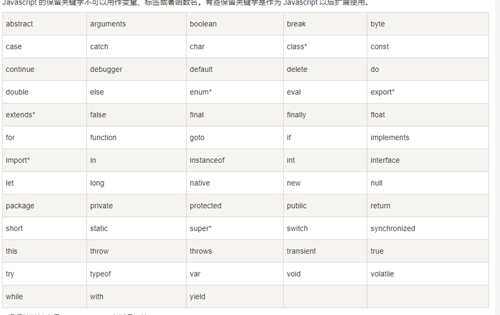

## JavaScript基础

### 概述

JavaScript是目前web开发中不可缺少的脚本语言，==js不需要编译即可运行，运行在客户端，需要通过浏览器来解析执行JavaScript代码。==

诞生于1995年，当时的主要目的是验证表单的数据是否合法。

JavaScript本来应该叫Livescript，但是在发布前夕，想搭上当时超热的java顺风车，临时把名字改为了JavaScript。（也就是说js跟java没有关系，当时只是想借助java的名气）。

 

javaScript 被用来改进设计、验证表单、检测浏览器、创建cookies，等等。JavaScript 是因特网上最流行的脚本语言，并且可在所有主要的浏览器中运行，比如： Internet Explorer、 Maxthon、Mozilla、Firefox、Netscape、Chrome和 Opera等。

常用 ==（1） 修改html及css代码== （2）验证表单

---


### 1.嵌入方法

#### 1.1 内嵌式

理论上js可以写在任何第一个地方 但是一般写在head标签里或者 body下

```javascript
<script type="application/javascript">
alert("内嵌式");
</script>
<script>alert("内嵌式");</script>
```

#### 1.2 外链式

首先新建一个文件类型为.js的文件，然后在该文件中写js语句，通过script标签对引入到html页面中。

`` <script src="js文件路径地址">这里不能写js语句</script>``

#### 1.3 行内式

直接书写在标签身上，是一个简写的事件，所以又称之为事件属性。   onclick单击事件

```javascript
<input type="button" value="点我呀!" onclick="alert('暗月渗透测试培训');">
<button onclick="alert('恭喜你,加入暗月渗透测试培训');">点我呀!</button>
```

### 2.语句

1.在编程语言中，这些编程指令被称为语句。

JavaScript 程序就是一系列的编程语句。

注释：在 HTML 中，JavaScript 程序由 web 浏览器执行。

2.JavaScript 语句由以下构成：

值、运算符、表达式、关键词和注释。

==3.用分号（;）分隔JavaScript语句。==

### 3.注释

单行注释：     //   注释语句       快捷键ctrl+/

多行注释：     /* 注释语句 */  快捷键ctrl+shift+/  

==注意：多行注释相互不能嵌套使用，只能在多行注释里面使用单行注释！==

### 4.变量

变量是用于存储信息的"容器" 

==javascript单双引号没区别==

var a=’moonsec’;

### 5.JavaScript 保留关键字

Javascript 的保留关键字不可以用作变量、标签或者函数名。有些保留关键字是作为 Javascript 以后扩展使用。



### 6.JavaScript 作用域

#### 6.1 Javascript 局部变量

局部作用域 变量在函数内声明，变量为局部作用域。

```javascript
function myFunction() {
    var carName = "Volvo";
    // 函数内可调用 carName 变量
}
```

#### 6.2 JavaScript 全局变量

变量在函数外定义，即为全局变量。

全局变量有 全局作用域: 网页中所有脚本和函数均可使用。 

```js
var carName = " Volvo";
// 此处可调用 carName 变量
function myFunction() {
    // 函数内可调用 carName 变量
}
```

### 7.数据类型

数值型：number（凡是数字都是数值型，不区分整数和小数）

字符串：string（凡是引号包裹起来的内容全部都是字符串）

布尔：boolean（true、false）

对象类型：object（特殊取值null）

未定义型：undefined

对象类型 数组 字典

#### 7.1 判断类型

```js
var a = "iamstring.";
var b = 222;
var c= [1,2,3];
var d = new Date();
var e = function(){alert(111);};
var f = function(){this.name="22";};　

alert(typeof a)  ------------> string
alert(typeof b)  ------------> number
alert(typeof c)  ------------> object
alert(typeof d)  ------------> object
alert(typeof e)  ------------> function
alert(typeof f)  ------------> function
```

#### 7.2 数字类型

只有一种数字类型，数字 可以是小数 ，也可以的整数以0开头 默认使用8进制来表示我的这个数字 ，以0x开头 默认使用16进制来表述我的这个数字  如果以-开头 默认以负数  如果我带有e：以科学计数法来解析我的这个数字

parseInt(..)  将某值转换成数字，不成功则NaN

parseFloat(..) 将某值转换成浮点数，不成功则NaN

特殊值：

NaN，非数字。可使用 isNaN(num) 来判断。

Infinity，无穷大。可使用 isFinite(num) 来判断。

#### 7.3 字符串型

字符串是存储字符的变量，用来表示文本的数据类型，程序中的字符串是包含单引号/双引号的，由单引号来界定我双引号中包含的字符串 

 ```js
 obj.length              长度
 
 obj.trim()              移除空白
 
 obj.trimLeft()
 
 obj.trimRight)
 
 obj.charAt(n)            返回字符串中的第n个字符
 
 obj.concat(value, ...)        拼接
 
 obj.indexOf(substring,start)     子序列位置
 
 obj.lastIndexOf(substring,start)   子序列位置
 
 obj.substring(from, to)       根据索引获取子序列
 
 obj.slice(  , end)        切片
 
 obj.toLowerCase()          大写
 
 obj.toUpperCase()          小写
 
 obj.split(delimiter, limit)     分割
 
 obj.search(regexp)          从头开始匹配，返回匹配成功的第一个位置(g无效)
 
 obj.match(regexp)          全局搜索，如果正则中有g表示找到全部，否则只找到第一个。
 
 obj.replace(regexp, replacement)   替换，正则中有g则替换所有，否则只替换第一个匹配项，
 
 ​                   $数字：匹配的第n个组内容；
 
 ​                   $&：当前匹配的内容；
 
 ​                   $`：位于匹配子串左侧的文本；
 
 ​                   $'：位于匹配子串右侧的文本
 
 ​                   $$：直接量$符号
 
 
 ```

####  7.4布尔类型(boolean)

一般是用在流程控制语句中，字符串和数字类型都是无穷多个，然而我们的布尔数据类型只有两个：true 和 false

这两个个值一般用于说明某个事物是真或者假

==js一般用布尔类型来比较所得到的结果==

 

布尔类型仅包含真假，

==   比较值相等     !=    不等于    ===  比较值和类型相等

!=== 不等于     ||    或        &&   且

#### 7.5 null

null

关键字null是一个特殊的值，它表示变量为空值，用来定义空的或者是不存在的引用。

如果试图去引用一个没有定义的值，就会返回一个null。

这里注意一点：null并不等于"" 或者0

#### 7.6 undefined(未定义)

这个值表示变量不含有值，没有定义的值，或者被定义了一个不存在的属性值

！null和undefined区别：

null它表示一个变量被赋予一个空值，而undefined是表示变量还没有被赋值

#### 7.7 数组

- 1、数组内可以存放任意数据类型的数据（本质上它也是对象）

- 2、数组元素不赋值的情况下 值为undefined

- 3、如果数组打印的时候，元素不赋值""

- 4、访问数组范围之外的元素，不会出现越界的问题，undefined

- 5、定义数组大小，照样可以添加更多元素

##### 7.7.1 定义数组的方法

1、var arr=[]//定义一个空数组

2、var arr=[10,20,{"name":"tomy","age":19},0.1,"string",true,["aaa","bbb"]]//定义的同时赋值

3、var arr=new Array();//定义一个空数组

4、var arr = new Array(10,20,{"name":"tomy","age":19},0.1,"string",true,["aaa","bbb"])//定义的同时赋值

5、var arr=new Array(10)//定义一个长度为10的数组

##### 7.7.2 数组的操作

```js
obj.length          数组的大小
obj.push(ele)       尾部追加元素
obj.pop()           尾部获取一个元素
obj.unshift(ele)    头部插入元素
obj.shift()         头部移除元素
obj.splice(start, deleteCount, value, ...)  插入、删除或替换数组的元素
                    obj.splice(n,0,val) 指定位置插入元素
                    obj.splice(n,1,val) 指定位置替换元素
                    obj.splice(n,1)     指定位置删除元素
obj.slice( )        切片
obj.reverse( )      反转
obj.join(sep)       将数组元素连接起来以构建一个字符串
obj.concat(val,..)  连接数组
obj.sort( )         对数组元素进行排序
```

### 8.函数

JavaScript 函数语法

JavaScript 函数通过 function 关键词进行定义，其后是函数名和括号 ()。

函数名可包含字母、数字、下划线和美元符号（规则与变量名相同）。

圆括号可包括由逗号分隔的参数：

```js
var x = myFunction(7, 8);        // 调用函数，返回值被赋值给 x
function myFunction(a, b) {
    return a * b;                // 函数返回 a 和 b 的乘积
}
```

普通函数：

```js
function func(arg){
	return arg+1;
		}
		
	var result = func(1);
	console.log(result);		var result = func(1);
	console.log(result);
```

匿名函数：

```js
setInterval(function(){
		console.log(123);
},500)
```

自执行函数：

```js
(function(arg){
	console.log(arg);
})(1);
```

### 9.字典

字典 是一种以键-值对形式存储数据的数据结构

`var dict = {'k1':"moonsec",'k2':'moon','age':18};`

输出字典元素

```js
for(var item in dict){

console.log(dict[item]);

}
```

获取指定元素

dict['age'] 获取key为age的元素

赋值

`dict['age']=10`

删除元素

`delete dict['one'];`

`delete dict.age;`


### 10.js 的序列化和反序列化

Json与字符串的转换   把对象转为字符串    JSON.stringify()

把字符串转为数组   newli = JSON.parse()

 

**序列化** 即js中的Object转化为字符串

使用toJSONString

`var last=obj.toJSONString(); //将JSON对象转化为JSON字符 `

使用stringify

` var last=JSON.stringify(obj); //将JSON对象转化为JSON字符 `

**反序列化**  即js中JSON字符串转化为Object


### 11.转义

就是网站的网址大部分是URL编码的，所以我们要进行转义

-  decodeURI( )          URl中未转义的字符

- decodeURIComponent( )  URI组件中的未转义字符

- encodeURI( )          URI中的转义字符

- encodeURIComponent( )  转义URI组件中的字符

- escape( )             对字符串转义

- ==unescape( )           给转义字符串解码==

- URIError             由URl的编码和解码方法抛出

### 12.eval

==eval() 函数可计算某个字符串，并执行其中的的 JavaScript 代码。==

### 13.时间

```js
Date 对象
var myDate = new Date();  
myDate.getYear(); //获取当前年份(2位)  
myDate.getFullYear(); //获取完整的年份(4位,1970-????)  
myDate.getMonth(); //获取当前月份(0-11,0代表1月) 所以获取当前月份是 myDate.getMonth()+1;   
myDate.getDate(); //获取当前日(1-31)  
myDate.getDay(); //获取当前星期X(0-6,0代表星期天)  
myDate.getTime(); //获取当前时间(从1970.1.1开始的毫秒数)  
myDate.getHours(); //获取当前小时数(0-23)  
myDate.getMinutes(); //获取当前分钟数(0-59)  
myDate.getSeconds(); //获取当前秒数(0-59)  
myDate.getMilliseconds(); //获取当前毫秒数(0-999)  
myDate.toLocaleDateString(); //获取当前日期  
var mytime = myDate.toLocaleTimeString(); //获取当前时间  
myDate.toLocaleString( ); //获取日期与时间  
加一天 
var dateTime = new Date();  
dateTime=dateTime.setDate(dateTime.getDate()+1);
dateTime=new Date(dateTime);
dateTime=dateTime.setDate(dateTime.getDate()+1);
```

### 14.面向对象

JavaScript是一种基于原型的语言，它没类的声明语句，比如C+ +或Java中用的。这有时会对习惯使用有类申明语句语言的程序员产生困扰。相反，JavaScript可用方法作类。定义一个类跟定义一个函数一样简单。在下面的例子中，我们定义了一个新类Person。

第一种方法

```js
function Person(name) {
     //构造函数里面的方法和属性
    this._name = name;
    this.getName = function () {
         console.log(this._name);
     };
     this.setName = function (name) {
         this._name = name;
     };
 }
 
 var p = new Person("张三");
 p.getName();  // 张三
 p.setName("李四");
 p.getName();  // 李四
```

对于上述代码需要注意： ==Person充当的构造函数   this代指对象  创建对象时需要使用 new==

第二种方法

```js
// 定义类class Person {
     //类的构造函数，实例化的时候执行，new的时候执行
     constructor(name) {
         this._name = name;
     }
     getName() {
         console.log(this._name);
     }
     setName(name) {
        this._name = name
    }
}
 let p = new Preson('张三')
 p.getName();  // 张三
 p.setName('李四');
 p.getName();  // 李四
```

### 15.原型

我们所创建的每一个函数，解析器都会向函数中添加一个属性prototype

这个属性对应着一个对象，这个对象就是我们所谓的原型对象

如果函数作为普通函数调用时 prototype没有任何作用

当函数以构造函数调用时，它所创建的对象中都会有一个隐含的的属性

指向该构造函数的原型 我们可以通过__proto__来访问该属性

我们可以将对象中公有的内容，统一设置到原型对象中

```js
function Persion(username,age){
}
//console.log(Persion.prototype);
var p = new Persion();
console.log(p.__proto__ == Persion.prototype);


定义原型变量和原型变量
function Persion(username,age){

}
//console.log(Persion.prototype);
Persion.prototype.a = '女';
Persion.prototype.Sayname=function(){
	return Persion.name;
}
var p1 = new Persion('moonsec');
var p2 = new Persion();
alert(p1.Sayname());
```

### 16.运算符

用于执行程序代码运算，会针对一个以上操作数来进行

#### 16.1 算术运算符

\+  -  *  /  % ++ --

“+”可用作字符串的拼接

#### 16.2 比较运算符

<      \>     ==     ！=      <=      \>=

> === 全等于：将数值以及数据类型一并比较

> ！==不全等于：将数值以及数据类型一并比较

#### 16.3 赋值运算器

```js
=
+= 
-=
*=
/=
%=
a=a+2;==>a+=2
a=a-2;==>a-=2
a=a*2;==>a*=2
a=a/2;==>a/=2
a=a%2;==>a%=2
```

#### 16.4 逻辑运算符

> && 全真为真     || 一个为真就是真      ！ 取反

### 17.流程控制语句

#### 17.1 if语句

```js
if(条件){
函数体
}
```

#### 17.2 if else 语句

```js
if(条件){
函数体1
}else{
函数体2
}
```

#### 17.3 if……else 语句

```js
if(条件1){

}else if(条件2){

}else if(条件n){

}else{

}
```

#### 17.4 switch 语句：多分支语句

```js
switch(表达式) {
     case n:
        代码块
        break;
     case n:
        代码块
        break;
     default:
        默认代码块
} 

switch (new Date().getDay()) {
    case 6:
        text = "今天是周六";
        break; 
    case 0:
        text = "今天是周日";
        break; 
    default: 
        text = "期待周末~";
} 
```

#### 17.5while循环结构

while循环：先判断条件 当条件成立 再执行

while(循环成立条件){

....

}

#### 17.6 do……while 循环

```js
do...while循环:不论条件成不成立 先执行一遍 再判断
do{
.....
}while(循环成立条件)
```

#### 17.7 for循环

#### 17.8  for in 循环

continue：

跳过当前循环，直接进入循环的下一个步骤

break:

结束循环

### 18.JS操作DOM

#### 18.1 什么是DOM？

DOM（document object model）文档对象模型，是针对HTML和XML的一个API（应用程序接口）。DOM给我们描述了一个具有层次化特点的节点树，允许开发人员增删改查页面的某些部分。


- > JavaScript 能够改变页面中的所有 HTML 元素

- > JavaScript 能够改变页面中的所有 HTML 属性

- > JavaScript 能够改变页面中的所有 CSS 样式

- > JavaScript 能够对页面中的所有事件做出反应

#### 18.2 DOM查找元素

document获取节点的基本方法

document.getElementById('id'); //==通过id来获取元素==,返回指定的唯一元素。

document.getElementsByName("name"); //==通过name来获取元素==，返回name='name'的集合。

.document.getElementsByClassName("classname") //==用classname来获取元素==，返回的是一个class="classname"的集合(不兼容IE8及以下)。

document.getElementsByTagName('div'); //==用元素的标签获取元素==，返回所有标签=“div”的集合。

##### 18.2.1 查找

直接查找   var obj = document.getElementById('id');

间接查找

文件内容操作

innerText 仅文本

innerHTML 全内容

value

input value 获取当前的值

select 获取选中的value的值 document.getElementById('s1').selectedIndex=1

Textarea 获取value的值

##### 18.2.2 操作

样式操作

className 列出样式 字符串

classList 列出样式 返回数组

classList.add 增加样式

classList.remove 删除样式

 

```js
<div class='c1 c2' styple='font-size:16px'></div>
obj.style.fontSize='16px';
```

属性操作

获取属性   getAttribute()

增加设置一个属性 、添加属性   setAttribute('xxx','alexe')

删除属性  removeAttribute(value)

创建标签 并添加到html中     

第一种方式 字符串方式

```js
insertAdjacentHTML()

		<input type="button" value="+" onclick="add();"/>
		<div id="div1">
			<p><input type="text"/></p>
		</div>
		<script>
			function add(){
				var tag="<p><input type='text'></p>"
				document.getElementById('div1').insertAdjacentHTML('beforeEnd',tag);
			}
			
		</script>
	</body>
```

有四种值可用：

- beforeBegin: 插入到标签开始前

- afterBegin:插入到标签开始标记之后

- beforeEnd:插入到标签结束标记前

- afterEnd:插入到标签结束标记后

第二种方式 对象的方式

```js
document.createElement
<input type="button" value="+" onclick="add2();"/>
		<div id="div1">
			<p><input type="text"/></p>
		</div>
		<script>
			function add(){
				var tag="<p><input type='text'></p>"
				document.getElementById('div1').insertAdjacentHTML('beforeEnd',tag);
			}
			function add2(){
				var tag =document.createElement('input');
				tag.setAttribute('type','text');
				tag.style.color='red';
				var p =document.createElement('p');
				p.appendChild(tag)	document.getElementById('div1').appendChild(p);
			}
	</script>appendChild 在节点后面增加一个子节点
```

提交表单

任何标签都可以通过dom提交

```js
getElementById('id').submit()
				<form id='f1' action="https://www.moonsec.com/">
			<input type="submit" value="提交" />
			<input type="button" value="botton" onclick="Sub();" />
			<a onclick="Sub();">提交</a>
		</form>
		<script>
			function Sub(){
				document.getElementById('f1').submit();
			}
			
		</script>
```

其他

console.log 终端输出

alert 弹出框

confirm 确认框 标题 true false

 

url和刷新

location.href 获取url

location.href ='url' 重定向

location.reload() 重新加载


定时器

setInterval()

clearInterval()

```js
<input id="i1" type="text" />
		<input type="button" value="停止" onclick="stop();">		
		<script>
		function setTime(){
			var tag = new Date();
	document.getElementById('i1').value=tag;
		}
		var obj=setInterval('setTime()','500');
		function stop(){
			clearInterval(obj);
		}
```

只执行一次

setTimeout()

clearTimeout()

```js
<div id="status"></div>
		<input type="button" value="删除" onclick="Delele();">
	<script>
	function Delele(){	document.getElementById('status').innerText="已删除";
		setTimeout(function(){
			document.getElementById('status').innerText="";
		},5000)
	}
	</script>
```

事件

绑定事件两种方式

a.直接标签绑定 直接标签绑定 onclick=''

b.先获取dom对象，然后进行绑定

document.getElementById('xxx').onclick()


