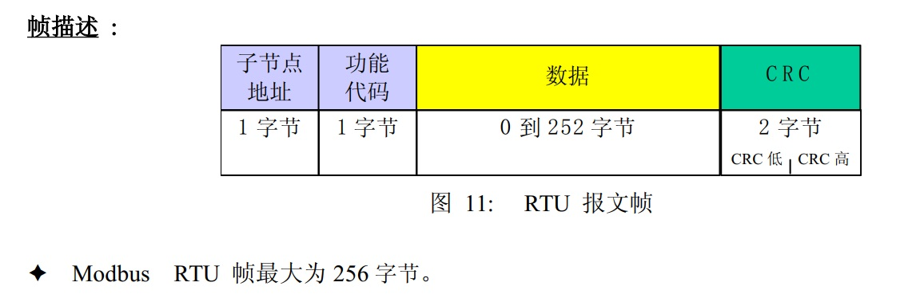

## MODBUS RTU协议

MODBUS  RTU通信规约



信息传输为异步方式，并以字节为单位，每个字节由8 位二进制数组成：

异步：异步双方不需要共同的时钟，也就是接收方不知道发送方什么时候发送，所以在发送的信息中就要有提示接收方开始接收的信息，如开始位，同时在结束时有停止位。

异步的另外一种含义是计算机多线程的异步处理。与同步处理相对，异步处理不用阻塞当前[线程](https://baike.baidu.com/item/线程/103101)来等待处理完成，而是允许后续操作，直至其它线程将处理完成，并回调通知此线程。

但此处需要明确的是:异步与[多线程](https://baike.baidu.com/item/多线程/1190404)与并行不是同一个概念.

| 起始位     | 1位     |
| ---------- | ------- |
| 数据位     | 8位     |
| 奇偶校验位 | 无校验  |
| 停止位     | 1位     |
| 流控       | 无流控  |
| 通讯速率   | 9600bps |


每个数据帧组成如下：（RTU模式）

 

| 地址码 | 功能码 | 数据信息 | CRC 校验 |
| ------ | ------ | -------- | -------- |
| 8 位   | 8 位   | N*8 位   | 16 位    |

地址码：信息发送过来必然有个地址

功能码：就来告诉从机执行什么动作

通常用两个16位的数来表示，所以总共是8位

| **功能码** | **定 义**              | **说明**         |
| ---------- | ---------------------- | ---------------- |
| 01H        | Read Coil Status       | 读写一个Coil     |
| 02H        | Read Input Status      | 只读一个Coil     |
| 03H        | Read Holding Registers | 读写寄存器数值   |
| 04H        | Read Input Registers   | 只读寄存器数值   |
| 05H        | Force Single Coil      | 修改一个Coil值   |
| 06H        | Preset Single Register | 修改一个寄存器值 |
| 0FH        | Force Multiple Coils   | 修改多个Coil值   |
| 10H        | Load Multiple Register | 修改多个寄存器值 |

数据区

数据区包括需要由从机返送何种信息或执行什么动作。这些信息可以是数据、参考地址等。


错误校验码（16 位CRC 校验）

主机或从机可用校验码进行判别接收信息是否正确。由于电子噪声或一些其它干扰， 信息在传输过程中有时会发生错误，错误校验码（CRC）可以检验主机或从机在通讯数据传送过程中的信息是否有误，错误的数据可以放弃（无论是发送还是接收），这样增加了系统的安全和效率。

MODBUS 通讯规约的CRC（冗余循环码）包含2个字节，即16位二进制数。CRC码由发送设备（主机）计算，放置于发送信息帧的尾部（CRC 高字节在前）。接收信息的设备（从机）再重新计算接收到信息的CRC，比较计算得到的CRC 是否与接收到的相符，如果两者不相符，则表明出错。

16位CRC校验。 CRC-16 = *x*^16 + *x*^12 + *x*^5 + *x*^0

计算步骤为：

(1).预置16 位寄存器为十六进制FFFF（即全为1），称此寄存器为CRC 寄存器； 

(2).把第一个8 位数据与16 位CRC 寄存器的==低位相异或==，把结果放于CRC 寄存器； 

(3).把寄存器的内容右移一位(朝低位)，用0 填补最高位，检查最低位

（注意：这时的最低位指移位前的最低位，不是移位后的最低位）；

(4). 如果最低位为0：重复第3 步(再次移位)，如果最低位为1：CRC 寄存器与多项式

A001H（1010000000000001B）进行异或；

(5). 重复步骤3 和4，直到右移8 次，这样整个8 位数据全部进行了处理；

(6). 重复步骤2 到步骤5，进行下一个8 位数据的处理；

(7). 最后得到的CRC 寄存器即为CRC 码。

(8).CRC计算参考代码

```c++
unsigned int calculate_CRC(unsigned char *ptr, unsigned int len)
{
unsigned int crc=0xffff; unsigned char i; while(len!=0)
{
crc^=*ptr;// crc寄存器与数据的8位进行异或
 
for(i=0;i<8;i++)
{
if((crc&0x0001)==0/*与   如果是0就进行移位*/) crc=crc>>1; else
{
crc=crc>>1; crc^=0xa001;
}
}
len-=1; ptr++;
}
crc=(crc<<8) | (crc>>8);//高低字节取反
    return crc;
}

```

#### 传输格式

#####  命令报文格式

数据传输分为被动和主动以及自己传输和接受

被动比如是打开某个东西然后自动发送某东西

主动就是主动发信息

在传输过程中，数据遵循的一些规则统称为协议

不同设备之间，协议是不同的

协议有底层协议和高层协议

这是一个底层协议

校验码的那些一般都是规定好的，是大家通用的，不需要去学的特别清楚，了解就行。

==地址是设备地址与起始地址是不同的==

起始地址是你需要的东西储存的地址

1） Read Coil Status

==数据个数要看你需要的东西占多少字节==

==功能码“01H”能读取位元，==      读写

 

| 地址 | 功能码 | 起始地址 |      | 数据个数 |      | CRC  |      |
| :--: | ------ | -------- | ---- | -------- | ---- | ---- | ---- |
|  01  | 01     | 高位     | 低位 | 高位     | 低位 | 高位 | 低位 |

返回

 

| 地址 | 功能码 | 字节个数 | 数据       | CRC  |      |
| ---- | ------ | -------- | ---------- | ---- | ---- |
| 01   | 01     | N（8位） | 数据N..  1 | 高位 | 低位 |

 

2） Read Input Status： 功能码“02H”能读取位元，

| 地址 | 功能码 | 起始地址 |      | 数据个数 |      | CRC  |      |
| ---- | ------ | -------- | ---- | -------- | ---- | ---- | ---- |
| 01   | 02     | 高位     | 低位 | 高位     | 低位 | 高位 | 低位 |

返回

 

| 地址 | 功能码 | 字节个数 | 数据       | CRC  |      |
| ---- | ------ | -------- | ---------- | ---- | ---- |
| 01   | 02     | N（8位） | 数据N..  1 | 高位 | 低位 |

 

3） Read Holding Registers

功能码“03H”能够访问所有内部保持寄存器。

 

| 地址 | 功能码 | 起始地址 |      | 数据个数 |      | CRC  |      |
| ---- | ------ | -------- | ---- | -------- | ---- | ---- | ---- |
| 01   | 03     | 高位     | 低位 | 高位     | 低位 | 高位 | 低位 |

返回

 

| 地址 | 功能码 | 字节个数 | 数据                         | CRC  |      |
| ---- | ------ | -------- | ---------------------------- | ---- | ---- |
| 01   | 03     | 2N       | 数据1（16位）……数据N（16位） | 高位 | 低位 |

 

4） Read Input Registers：

功能码“04H”能够访问所有外部输入寄存器。

 

| 地址 | 功能码 | 起始地址 |      | 数据个数 |      | CRC  |      |
| ---- | ------ | -------- | ---- | -------- | ---- | ---- | ---- |
| 01   | 04     | 高位     | 低位 | 高位     | 低位 | 高位 | 低位 |

返回：

 

| 地址 | 功能码 | 字节个数 | 数据                         | CRC  |      |
| ---- | ------ | -------- | ---------------------------- | ---- | ---- |
| 01   | 04     | 2N       | 数据1（16位）……数据N（16位） | 高位 | 低位 |

 

5） Force Single Coil：

功能码“05H”能够设置一个位元，这里的数据就是一个字节，只可能是0xFF 00 或者0x00 00。0xFF 00代表开机 0x00 00代表关机。

| 地址 | 功能码 | 地址 |      | 数据 |      | CRC  |      |
| ---- | ------ | ---- | ---- | ---- | ---- | ---- | ---- |
| 01   | 05     | 高位 | 低位 | 高位 | 低位 | 高位 | 低位 |

返回：

 

| 地址 | 功能码 | 地址 |      | 数据 |      | CRC  |      |
| ---- | ------ | ---- | ---- | ---- | ---- | ---- | ---- |
| 01   | 05     | 高位 | 低位 | 高位 | 低位 | 高位 | 低位 |

 

6） Preset Single Register

功能码“06H”能修改一个内部保持寄存器。

 

| 地址 | 功能码 | 地址 |      | 数据 |      | CRC  |      |
| ---- | ------ | ---- | ---- | ---- | ---- | ---- | ---- |
| 01   | 06     | 高位 | 低位 | 高位 | 低位 | 高位 | 低位 |

返回：

 

| 地址 | 功能码 | 地址 |      | 数据 |      | CRC  |      |
| ---- | ------ | ---- | ---- | ---- | ---- | ---- | ---- |
| 01   | 06     | 高位 | 低位 | 高位 | 低位 | 高位 | 低位 |

 

7） Force Multiple Coils：

功能码“0FH”，能根据位元的位设置多个量。

 

| 地址 | 功能码 | 起始地址 | 数据个数 | 数据个数 |      | 字节个数 | 数据            | CRC  |      |
| ---- | ------ | -------- | -------- | -------- | ---- | -------- | --------------- | ---- | ---- |
| 01   | 15     | 高位     | 低位     | 高位     | 低位 | N        | 字节（8位）1……N | 高位 | 低位 |

返回：

 

| 地址 | 功能码 | 起始地址 |      | 数据个数 |      | CRC  |      |
| ---- | ------ | -------- | ---- | -------- | ---- | ---- | ---- |
| 01   | 15     | 高位     | 低位 | 高位     | 低位 | 高位 | 低位 |

 

8） Load Multiple Register

功能码“10H”，能根据连续地址修改内部多个保持寄存器。

 

| 地址 | 功能码 | 起始地址 |      | 数据个数 |      | 字节个数 | 数据             | CRC  |      |
| ---- | ------ | -------- | ---- | -------- | ---- | -------- | ---------------- | ---- | ---- |
| 01   | 16     | 高位     | 低位 | 高位     | 低位 | 2N       | 数据（16位）1……N | 高位 | 低位 |

返回：

 

| 地址 | 功能码 | 起始地址 |      | 数据个数 |      | CRC  |      |
| ---- | ------ | -------- | ---- | -------- | ---- | ---- | ---- |
| 01   | 16     | 高位     | 低位 | 高位     | 低位 | 高位 | 低位 |

#####  异常应答返回（测试时开放，实际使用时屏蔽） 非法功能：


| 从站地址 | 功能码       | 异常码 | CRC  |      |
| -------- | ------------ | ------ | ---- | ---- |
| 01       | 80H+原功能码 | ERR    | 高位 | 低位 |

ERR ：01 非法功能

02 非法数据地址

03 非法数据值

04 非法个数

05 CRC错误

06 从机忙状态


[2022-05-31 17:34:39:731]: Send:8 char    8字节  

01 02 00 00 00 0F 38 0E               数据个数15个 ？   

[2022-05-31 17:34:39:840]: Recv:7 char

01 02 02 00 00 B9 B8          数据位00 00？
[2022-05-31 17:34:39:951]: Send:8 char    8字节

01 03 00 00 00 04 44 09       4个数据
[2022-05-31 17:34:40:060]: Recv:13 char

01 03 ==08== 00 00 60 18 00 00 15 4A 33 12    08表示2N   4个数据
[2022-05-31 17:34:40:172]: Send:8 char   8字节

01 04 00 00 00 0A 70 0D    数据个数10
[2022-05-31 17:34:40:282]: Recv:25 char

01 04 ==14== 08 E1 08 E7 08 E8 0F 66 0F 6C 0F 69 00 FC 00 00 00 E9 00 00 25 7A  

 20个数据   
[2022-05-31 17:34:40:391]: Send:8 char

01 04 00 0A 00 18 D0 02     数据24个
[2022-05-31 17:34:40:500]: Recv:2 char

01 84      

[2022-05-31 17:34:40:511]: 未收到足够信息（回包字节小于6）6字节=48b

[2022-05-31 17:34:40:514]: Send:8 char

01 04 00 0A 00 18 D0 02 
[2022-05-31 17:34:40:848]: Recv:2 char

01 84 

[2022-05-31 17:34:40:854]: 未收到足够信息（回包字节小于6）

[2022-05-31 17:34:40:856]: Send:8 char

01 04 00 0A 00 18 D0 02 
[2022-05-31 17:34:41:382]: Recv:2 char

01 84 

[2022-05-31 17:34:41:386]: 未收到足够信息（回包字节小于6）
[2022-05-31 17:34:41:387]: 本次采集结束

[2022-05-31 17:34:44:740]: Send:8 char

01 02 00 00 00 0F 38 0E 
[2022-05-31 17:34:44:847]: Recv:7 char

01 02 02 00 00 B9 B8 
[2022-05-31 17:34:44:956]: Send:8 char

01 03 00 00 00 04 44 09 
[2022-05-31 17:34:45:066]: Recv:13 char

01 03 08 00 00 60 18 00 00 15 4A 33 12 
[2022-05-31 17:34:45:176]: Send:8 char

01 04 00 00 00 0A 70 0D 
[2022-05-31 17:34:45:285]: Recv:25 char

01 04 14 08 E1 08 E7 08 E7 0F 66 0F 6B 0F 67 00 FF 00 00 00 EA 00 00 FF 6A 
[2022-05-31 17:34:45:396]: Send:8 char

01 04 00 0A 00 18 D0 02 
[2022-05-31 17:34:45:504]: Recv:2 char

01 84 

[2022-05-31 17:34:45:508]: 未收到足够信息（回包字节小于6）

[2022-05-31 17:34:45:510]: Send:8 char

01 04 00 0A 00 18 D0 02 
[2022-05-31 17:34:45:819]: Recv:2 char

01 84 

[2022-05-31 17:34:45:822]: 未收到足够信息（回包字节小于6）

[2022-05-31 17:34:45:824]: Send:8 char

01 04 00 0A 00 18 D0 02 
[2022-05-31 17:34:46:353]: Recv:2 char

01 84 

[2022-05-31 17:34:46:356]: 未收到足够信息（回包字节小于6）
[2022-05-31 17:34:46:358]: 本次采集结束

[2022-05-31 17:34:49:735]: Send:8 char

01 02 00 00 00 0F 38 0E 
[2022-05-31 17:34:49:842]: Recv:7 char

01 02 02 00 00 B9 B8 
[2022-05-31 17:34:49:952]: Send:8 char

01 03 00 00 00 04 44 09 
[2022-05-31 17:34:50:063]: Recv:13 char

01 03 08 00 00 60 18 00 00 15 4A 33 12 
[2022-05-31 17:34:50:174]: Send:8 char

01 04 00 00 00 0A 70 0D 
[2022-05-31 17:34:50:284]: Recv:25 char

01 04 14 08 DF 08 E6 08 E6 0F 63 0F 69 0F 65 00 FF 00 00 00 ED 00 00 E5 0B 
[2022-05-31 17:34:50:395]: Send:8 char

01 04 00 0A 00 18 D0 02 
[2022-05-31 17:34:50:507]: Recv:2 char

01 84 

[2022-05-31 17:34:50:511]: 未收到足够信息（回包字节小于6）

[2022-05-31 17:34:50:513]: Send:8 char

01 04 00 0A 00 18 D0 02 
[2022-05-31 17:34:50:824]: Recv:2 char

01 84 

[2022-05-31 17:34:50:827]: 未收到足够信息（回包字节小于6）

[2022-05-31 17:34:50:829]: Send:8 char

01 04 00 0A 00 18 D0 02 
[2022-05-31 17:34:51:346]: Recv:2 char

01 84 

[2022-05-31 17:34:51:349]: 未收到足够信息（回包字节小于6）

[2022-05-31 17:34:51:350]: 本次采集结束

