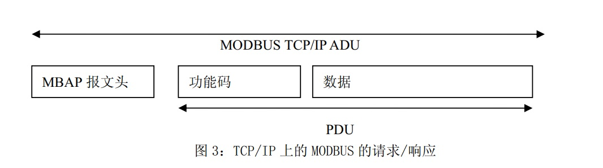

## MODBUS TCP协议

### Modbus TCP数据帧

　　ModbusTCP的数据帧可分为两部分：**MBAP**+**PDU**。

### MBAP报文头

　　MBAP的长度为7个字节，组成如下：

| 事务处理标识 | 协议标识 | 长度  | 单元标识符 |
| :----------: | -------- | ----- | ---------- |
|    2字节     | 2字节    | 2字节 | 1字节      |

| 内容             |                             解释                             |
| ---------------- | :----------------------------------------------------------: |
| **事务处理标识** | 可以理解为报文的序列号，一般每次通信之后就要加1以区别不同的通信数据报文。 |
| **协议标识符**   |                   00 00表示ModbusTCP协议。                   |
| **长度**         |              表示接下来的数据长度，单位为字节。              |
| **单元标识符**   |                     可以理解为设备地址。                     |

 

### 帧结构PDU

 

　　PDU由功能码+数据组成。功能码为1字节，数据长度不定，由具体功能决定。

　　**功能码**

根据对象的不同，常用的Modbus的功能码有：

| 功能码 |       含义       |
| ------ | :--------------: |
| 0x01   |      读coil      |
| 0x05   |    写单个coil    |
| 0x0F   |    写多个coil    |
| 0x02   |   读离散量输入   |
| 0x04   |   读输入寄存器   |
| 0x03   |   读保持寄存器   |
| 0x06   | 写单个保持寄存器 |
| 0x10   | 写多个保持寄存器 |

### Modbus TCP示例报文

　　1、数据请求

| 97 76 00 00 00 06 04 04 00 7D 00 7D |         |      |                  |                                                        |
| ----------------------------------- | ------- | ---- | ---------------- | ------------------------------------------------------ |
|                                     | 示例    | 长度 | 说明             | 备注                                                   |
| Map报文头                           | 0x97    | 1    | 事务处理标识符Hi | 客户机发起，服务器复制，用于事务处理配对               |
|                                     | 0x96    | 1    | 事务处理标识符Lo |                                                        |
|                                     | 0x0000  | 2    | 协议标识符号     | 客户机发起，服务器复制Modbus协议 = 0.                  |
|                                     | 0x0006  | 2    | 长度             | 从本字节下一个到最后                                   |
|                                     | 0x04    | 1    | 单元标识符       | 客户机发起，服务器复制串口链路或其他总线上远程终端标识 |
| 功能码                              | 0x04    | 1    | 功能码，读寄存器 | 参考标准modbus协议                                     |
| 数据                                | 0x007D  | 2    | 起始地址         |                                                        |
|                                     | 0x 007D | 2    | 寄存器数量       |                                                        |
| 校验                                |         |      |                  |                                                        |

　　2、数据请求回复

| 97 76 00 00 00 FD 04 04 FA ……………… |        |      |                  |                                                        |
| --------------------------------- | ------ | ---- | ---------------- | ------------------------------------------------------ |
|                                   | 示例   | 长度 | 说明             | 备注                                                   |
| Map报文头                         | 0x97   | 1    | 事务处理标识符Hi | 客户机发起，服务器复制，用于事务处理配对               |
|                                   | 0x96   | 1    | 事务处理标识符Lo |                                                        |
|                                   | 0x0000 | 2    | 协议标识符号     | 客户机发起，服务器复制Modbus协议 = 0.                  |
|                                   | 0x00FD | 2    | 长度             | 长度从本字节下一个到最后                               |
|                                   | 0x04   | 1    | 单元标识符       | 客户机发起，服务器复制串口链路或其他总线上远程终端标识 |
| 功能码                            | 0x04   | 1    | 功能码，读寄存器 | 参考标准modbus协议                                     |
| 数据                              | 0x FA  | 1    | 字节个数         |                                                        |
|                                   | 0x---- |      | 数据             |                                                        |
| 校验                              |        |      |                  |                                                        |

　　3、写多个寄存器

　　

| 97 79 00 00 00 09 04 10 00 00 00 01 02 00 01 |         |      |                  |                                                        |
| -------------------------------------------- | ------- | ---- | ---------------- | ------------------------------------------------------ |
|                                              | 示例    | 长度 | 说明             | 备注                                                   |
| Map报文头                                    | 0x97    | 1    | 事务处理标识符Hi | 客户机发起，服务器复制，用于事务处理配对               |
|                                              | 0x79    | 1    | 事务处理标识符Lo |                                                        |
|                                              | 0x0000  | 2    | 协议标识符号     | 客户机发起，服务器复制Modbus协议 = 0.                  |
|                                              | 0x0009  | 2    | 长度             | 从本字节下一个到最后                                   |
|                                              | 0x04    | 1    | 单元标识符       | 客户机发起，服务器复制串口链路或其他总线上远程终端标识 |
| 功能码                                       | 0x10    | 1    | 功能码，读寄存器 | 参考标准modbus协议                                     |
| 数据                                         | 0x0000  | 2    | 起始地址         |                                                        |
|                                              | 0x 0001 | 2    | 写寄存器数量     |                                                        |
|                                              | 0x 02   | 1    | 写字节的个数     |                                                        |
|                                              | 00 01   | 2    | 目标值           |                                                        |
| 校验                                         |         |      |                  |                                                        |

　　

　　4、写多个寄存器响应

　　

| 97 79 00 00 00 06 04 10 00 00 00 01 |         |      |                  |                                                        |
| ----------------------------------- | ------- | ---- | ---------------- | ------------------------------------------------------ |
|                                     | 示例    | 长度 | 说明             | 备注                                                   |
| Map报文头                           | 0x97    | 1    | 事务处理标识符Hi | 客户机发起，服务器复制，用于事务处理配对               |
|                                     | 0x79    | 1    | 事务处理标识符Lo |                                                        |
|                                     | 0x0000  | 2    | 协议标识符号     | 客户机发起，服务器复制Modbus协议 = 0.                  |
|                                     | 0x0006  | 2    | 长度             | 从本字节下一个到最后                                   |
|                                     | 0x04    | 1    | 单元标识符       | 客户机发起，服务器复制串口链路或其他总线上远程终端标识 |
| 功能码                              | 0x10    | 1    | 功能码，读寄存器 | 参考标准modbus协议                                     |
| 数据                                | 0x0000  | 2    | 起始地址         |                                                        |
|                                     | 0x 0001 | 2    | 寄存器个数       |                                                        |
| 校验                                |         |      |                  |                                                        |
