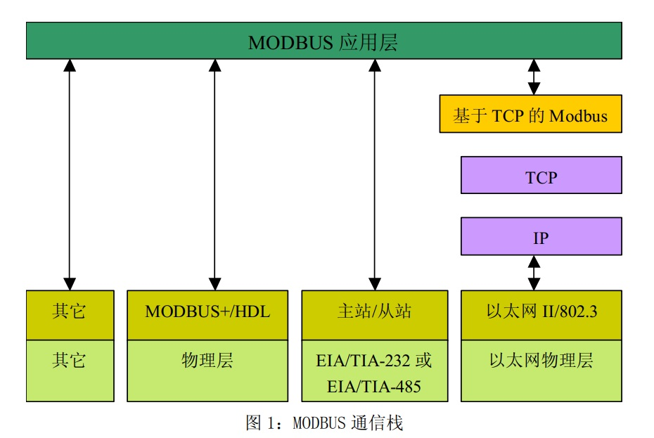
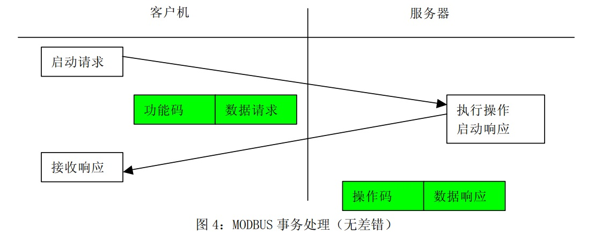
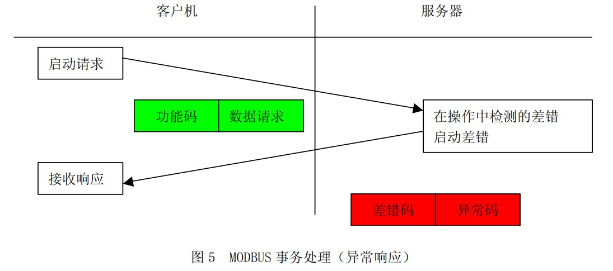
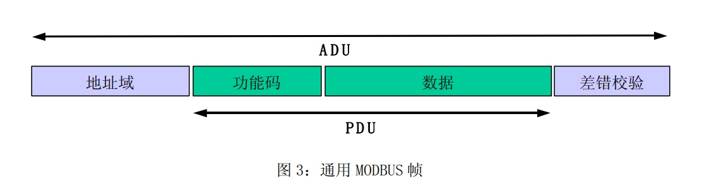
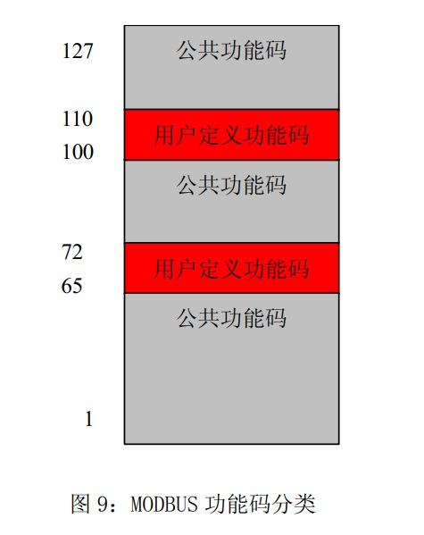
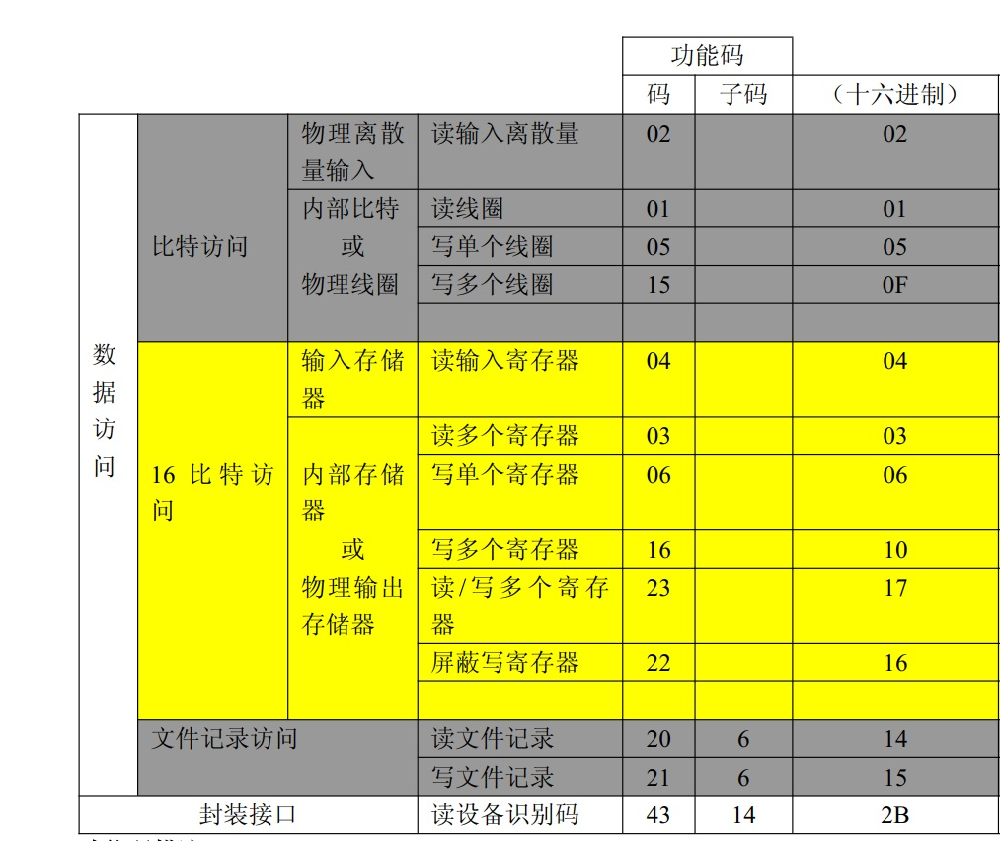

## Modbus通讯协议简介

### 简介

Modbus是工业领域通信协议的业界标准，是工业电子设备之间常用的连接方式。

特点：

- 公开发表并且无版权要求；
- 易于部署和维护；
- 对供应商来说，修改移动本地的比特或字节没有很多限制。

### Modbus 通讯方式

1、TCP/IP

2、各种媒体（有线：EIA/TIA-232-E、EIA-422、EIA/TIA-485-A ；光纤、无线等）上的异步串行传输；==Modbus RTU和Modbus ASCII通讯既是采用该方式；==

3、Modbus Plus，一种高速令牌传递网络。

### 协议描述

Modbus协议定义了一个控制器能认识使用的消息结构,而不管它们是经过何种网络进行通信的。它描述了一控制器请求访问其它设备的过程，如果回应来自其它设备的请求，以及怎样侦测错误并记录。

通过此协议，控制器相互之间、或控制器经由网络（如以太网）可以和其它设备之间进行通信。Modbus通讯物理接口可以选用串口（包括RS232、RS485和RS422），也可以选择以太网口。

通信过程：

**当主站不发送请求时，从站不会自己发出数据，从站和从站之间不能直接通讯。**

Modbus协议能够应用在不同类型的总线或者网络。对应不同的总线或网络，Modbus协议引入一些附加域映射成应用数据单元（ADU），即ADU = 附加域 + PDU。例如：

- RS232 / RS485 ADU = 253 字节+服务器地址(1 byte) + CRC (2 字节) = 256 字节 ；
- TCP MODBUS ADU = 249 字节+ MBAP (7 字节) = 256 字节 。

### 功能码

1.公共功能码

2.用户定义功能码

3.保留功能码

公共功能码：

